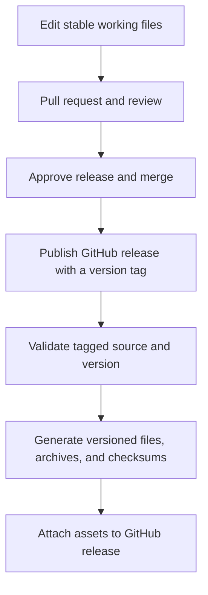

# PQC Maturity Model (PQCMM)

This repository is the versioned, machine-readable source package for the PKI Consortium PQC Maturity Model.

[](https://github.com/pkic/pqcmm/actions/workflows/validate.yml)

## Package contents

- `model/pqcmm-model.yaml` is the editable working model; versioned files in `model/` are immutable release snapshots.
- `profiles/pqcmm-self-assessment-profile.yaml` is the editable working profile; versioned files preserve released assessment behavior.
- `schemas/pqcmm-model.schema.json` and `schemas/assessment-profile.schema.json` are the working schemas; versioned files preserve released contracts. Portable assessment packages use the model-neutral schema maintained by the assessment tool.
- `scripts/validate.mjs` validates all current package contracts and stable identifiers.

The model and assessment profile are deliberately separate. Criteria and assessment questions remain immutable within a released model version, while form fields, cross-field subject rules, evidence limits, assurance states, report sections, and registered policy identifiers can advance in a separately versioned profile.

PQCMM requires at least one canonical CPE 2.3 name or package URL (pURL) for inventory correlation. The profile expresses that requirement through a generic `at-least-one` subject rule. Portable assessment credentials expose CPE and pURL as separate named properties; the runtime does not use a PQCMM-specific validation branch.

## Assurance boundary

The browser profile issues self-assessments only and does not apply signatures. It defines qualified third-party and PKI Consortium certification as external workflow states so a browser user cannot self-select them. The assessment does not store a proposed signer. Instead, the profile defines optional approval roles and PDF signature fields, and the external PAdES workflow establishes each actual signer at signing time. The current profile provides optional accountable-executive and security-executive fields and permits additional signatures. Identity, organization binding, role authority, document signature, trusted time, evidence review, assessor qualification, and certification issuance are separate assurance facets, allowing stronger combinations without imposing one credential stack on every user.

The planned PKI Consortium submission service may charge for processing, review, publication, signatures, status services, and long-term storage. That service is intentionally outside this repository and the offline assessment tool.

## Validate

```sh
pnpm install
pnpm run validate
```

## Releases

Edit the stable working paths above in pull requests so GitHub shows changes to the same files across versions. Internal model, profile, and schema versions identify the intended release; an unversioned filename does not imply approval or publication. Keep model and profile versions independent. When changing a released contract, advance its version before preparing a snapshot.

For review, compare the same working path between `main` and the draft branch. Establish the working paths on `main` first, then merge that baseline into the draft branch. Keep feedback proposals linked to their issues (using the relevant feedback or tracking issues); merging draft work does not itself approve or publish a release.



After release approval, open **Releases → Draft a new release** in GitHub, choose the approved commit or branch, create a new `v<model-version>` tag (for example, `v1.1.0`), and publish the release. No local commands are required for release managers.

GitHub Actions validates the tagged source, verifies the tag matches the model version, and automatically generates versioned model, profile, and schema assets, archives, and checksums. Wait for the release workflow to succeed before sharing the assets. Pushing a release tag directly also triggers this workflow and creates a release if needed.

Generated copies are attached to the GitHub release; they are not committed back into the repository. The tag preserves the exact working source. Asset filenames use the model version, independent profile version, and each document's schema version. Existing committed release snapshots remain unchanged, and generation rejects differences from an existing snapshot with the same version. Never move a published tag or replace published assets. Archives contain only the selected versioned assets and documentation.

The PKI Consortium website and assessment tooling should consume pinned, versioned release assets or a pinned commit. Reviewers and draft integrations may use the stable paths at an explicit commit.

## Contributing and license

See [CONTRIBUTING.md](CONTRIBUTING.md) for the authoring and versioning workflow. This repository is available under the [MIT License](LICENSE), and contributions are subject to the PKI Consortium [Intellectual Property Rights Agreement](https://pkic.org/ipr/).
